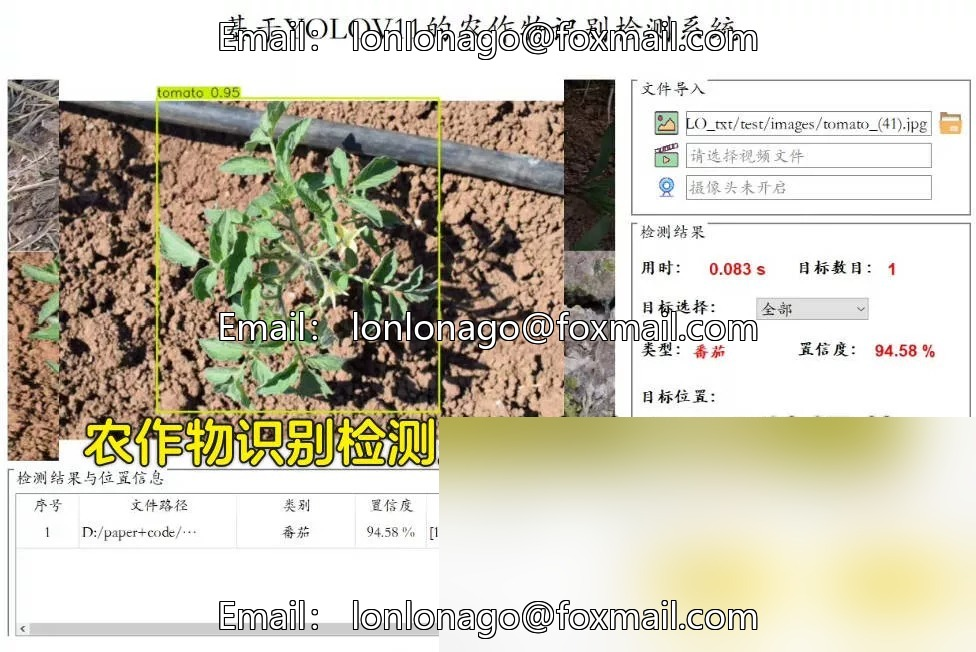
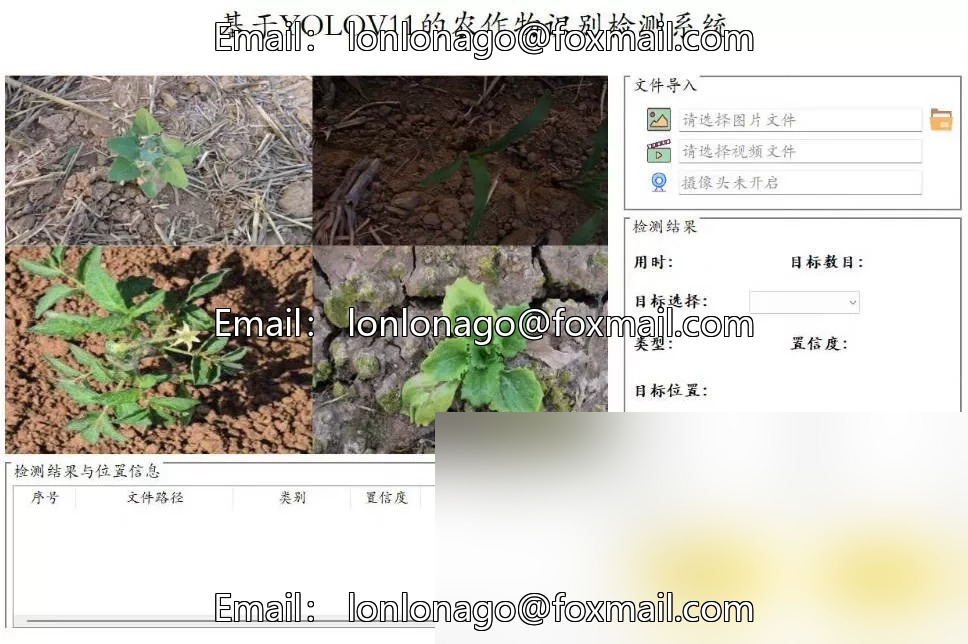
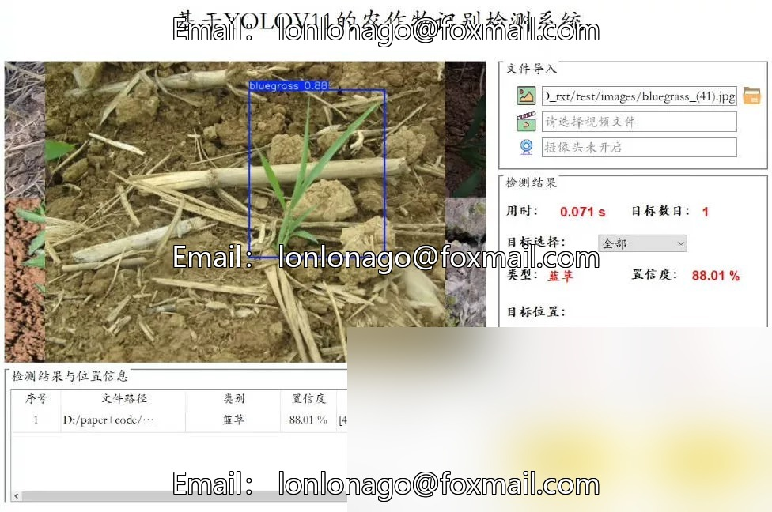
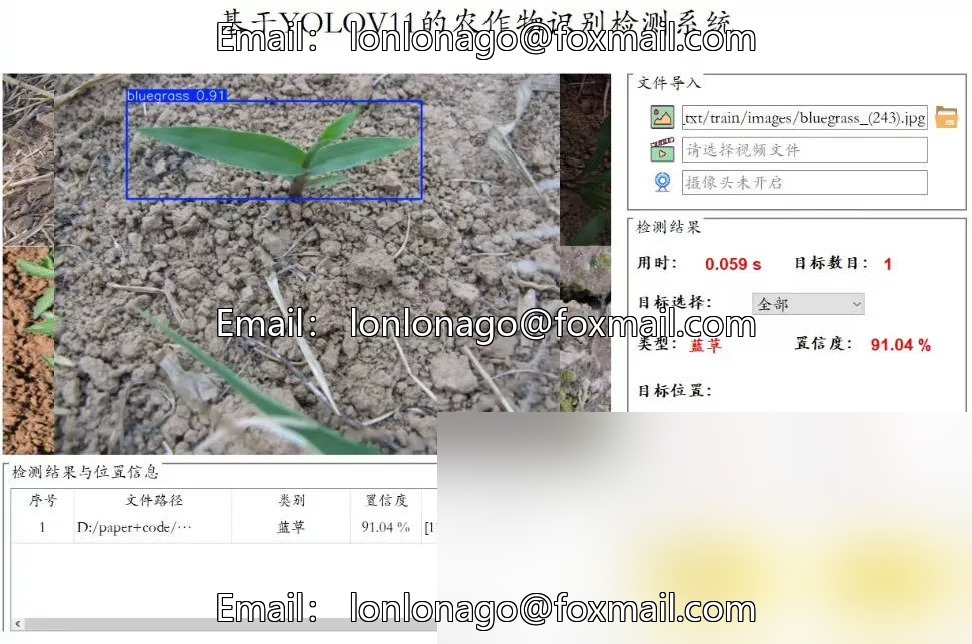
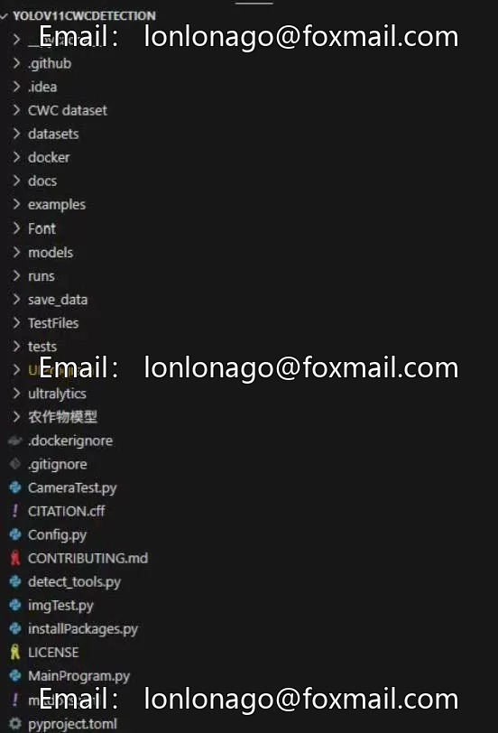

# A YOLOv11+pyqt5-based crop recognition and detection system contains CWC

## Body

A crop recognition detection system based on YOLOv11+pyqt5 contains the CWC dataset.
Including blue grass, salicornia, spear-leaf, corn, cotton, tomato species, tomato, taffeta, lettuce, radish, etc.11Classified crop

Complete source code source file + labeled dataset + trained model + environment configuration tutorial + program operation instructions document
Python + PyQt5 visualized interface
Recognize images, videos, and cameras
You can also replace the model and use this interface for other tasks to achieve custom detection target implementation

web-based shipment, can be directly photographed and shipped.

This dataset includes a YOLOv11+pyqt5 crop recognition detection system with a CWC dataset, source code, annotated data, trained models, visual interfaces, and configuration and run instructions; it also supports image, video, and camera-based recognition.

<!-- AI_ENRICHED -->

## Images

## Payment

Here is a pay link on Stripe ( https://buy.stripe.com/3cs8yP7sY87d0vu9AB ). Please contact me lonlonago@foxmail.com after funding $89, and I will send you a complete data files , thank you!

